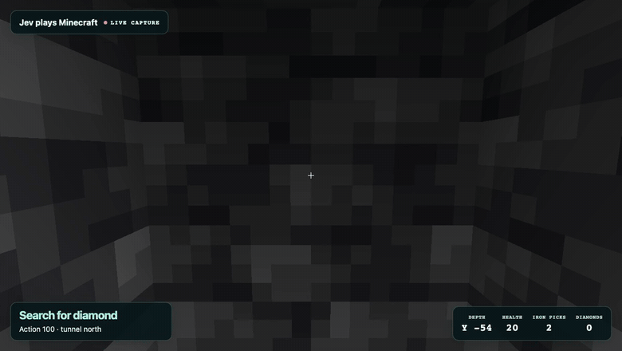

# Jev plays Minecraft

A survival Minecraft bot that uses [Jev](https://docs.typesafe.ai), TypeSafe's System One model, to pick every action on its way to a diamond. It runs against a private, offline 1.20.4 server in Docker.

## Watch a live survival run

[](docs/media/live-survival-run.mp4?raw=true)

[**Watch the full gameplay recording**](docs/media/live-survival-run.mp4?raw=true)

Recorded live from the bot's first-person viewer in a fresh vanilla Minecraft 1.20.4 world on Easy. The heuristic bot started with an empty inventory, crafted two iron pickaxes, and collected a naturally generated diamond in **102 actions, 9 minutes 37 seconds, and zero deaths**.

[Reconstructed replay of the earlier spare-pickaxe run](docs/media/spare-pickaxe-replay.mp4?raw=true)

## How it works

```text
 Minecraft server (Docker, offline, loopback only)
        ^ player protocol
        |
 Mineflayer bot ──> perception (line of sight only, no x-ray)
        |                 |
        |                 v
        |        objective ladder (code): wood -> stone -> iron -> smelt -> two iron pickaxes -> Y=-58
        |                 |
        |                 v
        |        legal actions for this moment (5–30 options)
        |                 |
        |                 v
        |        Jev: POST /v1/systemone, one "choice" question -> action + probabilities
        |                 |     (confidence below threshold or API error -> scripted pick)
        v                 v
     skills: mine, craft, smelt, dig down, tunnel, explore, fight, flee, eat
```

Code owns the control flow. Jev makes one narrow decision per step: which legal action to take next. This is the pattern TypeSafe recommends for System One models.

The bot crafts a spare iron pickaxe before descending. If the first pickaxe breaks during the search, it keeps mining with the spare.

## Run

```bash
cp .env.example .env          # set ACCEPT_MINECRAFT_EULA=TRUE and TYPESAFE_API_KEY
docker compose up --build     # server + bot
```

- Watch in a browser: http://localhost:3007 (needs the optional `canvas` package; see below)
- Or join with Minecraft Java 1.20.4 at `localhost:25565`
- Each run writes `events.jsonl` and `summary.json` in its own directory under `runs/`. Step events include the inventory, chosen action, and any Jev probabilities.

To iterate on the bot without rebuilding the image:

```bash
docker compose up -d minecraft
cd bot && npm install && POLICY=heuristic node src/main.js   # or POLICY=jev with TYPESAFE_API_KEY exported
```

To start over in a fresh world: `docker compose down -v`.

## Settings

| Variable | Default | Meaning |
| --- | --- | --- |
| `POLICY` | `jev` | `jev`, or `heuristic` for the scripted policy (no key needed) |
| `JEV_PROVIDER` | `typesafe` | `typesafe` (`api.typesafe.ai`) or `openrouter` (`typesafe/jev-1.13`; the OpenRouter route comes from a public demo and is not verified here) |
| `JEV_MIN_CONFIDENCE` | `0.2` | Below this confidence the bot uses the scripted pick |
| `DIFFICULTY` | `easy` | Server difficulty; `peaceful` removes hostile mobs |
| `WORLD_SEED` | `jev-diamonds` | Change it if the spawn is bad, for example in an ocean |
| `MAX_STEPS` | `3000` | Stop after this many decisions |

## Fair play

- The bot reports only blocks it can see (`bot.canSeeBlock` ray cast), so ore inside stone stays hidden until a tunnel exposes it.
- The bot is not an operator. It uses no commands and no server plugins.
- Jev gets text only: an objective, vitals, inventory, visible blocks, nearby mobs, recent outcomes, and a short list of crafting rules.

## Cost

Jev charges $42 per billion input tokens and nothing for output. A step sends about 1–2k tokens, so a 3,000-step run costs roughly $0.25. `summary.json` reports the estimate.

## Tests

```bash
cd bot
npm ci --omit=optional
npm test
```

The tests run without a Minecraft server or an API key. For a gameplay run on a private 1.20.4 server, set `POLICY=heuristic` and compare objective progress, failed actions, and deaths in the run logs.
